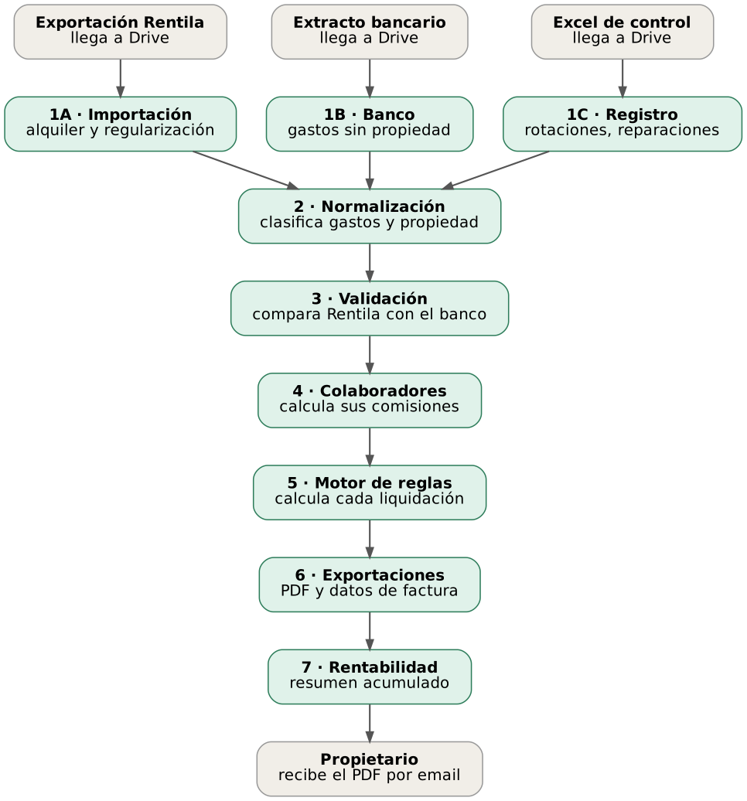

# 🏠 Property Settlement Automation

> Automatización mensual de liquidaciones a propietarios para una gestora inmobiliaria: importa datos de alquiler y banco, los concilia, aplica las reglas de negocio y entrega a cada propietario el PDF de liquidación y los datos de factura, sin cálculos manuales.

🇬🇧 [Read in English](README.md)

---

## ¿Qué problema resuelve?

Una gestora liquida cada mes ~80 propiedades y ~30 propietarios. Cada liquidación mezcla alquiler, suministros, gastos, honorarios, IVA, rotaciones de habitación y reparaciones, con reglas distintas según el tipo de gestión. Hacerlo en hojas de cálculo era lento y propenso a errores.

El sistema ejecuta el ciclo completo de forma automática y **marca para revisión humana lo dudoso en lugar de adivinar**.

> Proyecto freelance para un cliente real (3 hitos, aceptados y entregados). Este repositorio es una **versión pública saneada**: sin datos del cliente, credenciales ni identificadores reales.

## Puntos destacados

- **Motor de reglas determinista, sin LLM.** Honorarios, IVA, márgenes y umbrales son cálculos auditables. Cada liquidación guarda su desglose completo (`detalle_calculo`, JSONB).
- **PostgreSQL como núcleo del negocio**, no hojas de cálculo. Importaciones idempotentes (claves únicas + `ON CONFLICT`) y una liquidación por propiedad y mes.
- **Conciliación bancaria** entre la exportación de la plataforma de alquiler y el extracto, con estados explícitos: `validado`, `pendiente_validar`, `descuadrado`, `pago_parcial`.
- **Generación de PDF** con Gotenberg (HTML → PDF) y datos listos para facturar por concepto.
- **Parámetros de negocio en una tabla** (`configuracion`), modificables con un `UPDATE`, sin tocar workflows.
- **Validado contra datos reales:** los resultados coincidieron exactamente con el histórico del cliente en todas las propiedades probadas.
- **Operación incluida:** backups diarios con `pg_dump`, gestor de errores centralizado con alertas por email, logs, procedimiento de restauración y documentación de traspaso.

## Arquitectura



| Workflow | Función |
|---|---|
| 1A · Importación Rentila | Lee la exportación mensual de la plataforma de alquiler (ingresos + regularización bancaria) desde Drive a PostgreSQL |
| 1B · Banco | Importa gastos del extracto bancario, deduplicados por el ID de transacción del banco |
| 1C · Excel de control | Importa la hoja propia del cliente: rotaciones, reparaciones y pagos parciales |
| 2 · Normalización | Extrae periodos de contrato, clasifica gastos por palabras clave y resuelve la propiedad |
| 3 · Validación | Cruza plataforma y banco y fija el estado de conciliación |
| 4 · Colaboradores | Calcula comisiones de colaboradores externos |
| 5 · Motor de reglas | Recorre las propiedades y calcula ingresos, honorarios, IVA, rotaciones, reparaciones y neto |
| 6 · Exportaciones | PDF, datos de factura, facturas aparte y envío por email |
| 7 · Rentabilidad | Resumen acumulado por propiedad en una hoja |
| 8 · Detalle de movimientos, Panel de revisión | Manual: listado completo y listado de casos que necesitan revisión humana en Google Sheets |
| Logs / Error handler | Trazabilidad y alertas de fallo |

Stack: n8n (self-hosted) · PostgreSQL 16 · Gotenberg · Google Drive/Sheets/Gmail · Caddy (HTTPS) · Docker Compose.

Más detalle: [docs/architecture.md](docs/architecture.md) · [docs/business-rules.md](docs/business-rules.md) · [docs/lessons-learned.md](docs/lessons-learned.md)

## Limitaciones conocidas

Una lista honesta, porque se construyó con plazos de entrega reales:

- **SQL construido por interpolación de texto** en los nodos Postgres de n8n (`'{{ $json.x }}'` con escape manual de comillas). Las entradas vienen de ficheros internos de confianza, pero los *Query Parameters* de n8n serían más seguros.
- **Algunos valores siguen fijos en código**: el IVA en las plantillas de exportación/PDF (el motor de reglas sí lo lee de `configuracion`), las listas de palabras clave para clasificar gastos y algunas palabras de ubicación al resolver la propiedad.
- Algunos **logs** llevan contadores provisionales (p. ej. `propiedades_procesadas = 1`) en lugar de recuentos reales.
- Los sub-workflows se referencian por ID interno de n8n: tras importar hay que volver a enlazar los nodos *Execute Workflow*. Si un trigger *When Executed by Another Workflow* falla tras importar, bórralo y créalo de nuevo (Logs define 10 campos de entrada; los demás usan "Accept all data") y vuelve a fijar el *Error Workflow* en los ajustes de cada workflow.
- No hay batería de tests automáticos: la validación se hizo contra las cifras históricas del cliente.

## Probarlo

```bash
createdb settlements
psql settlements -f database/schema.sql
psql settlements -f database/seed_demo.sql
```

Después importa los JSON de `workflows/` en n8n (todos se exportan inactivos), crea tus credenciales de Postgres/Google, sustituye cada `REPLACE_WITH_YOUR_*` por tus IDs de carpeta/hoja de Drive y vuelve a enlazar los nodos *Execute Workflow*. Las notas dentro de los workflows (sticky notes) están en español.

## Estado

Entregado y traspasado al cliente en octubre de 2026 (acceso a Google revocado, administración de n8n transferida, documentación y backups entregados). Este repositorio público no se mantiene como producto.

## Autor

**Alejandro Peralta** — Especialista en Automatización de Procesos · [GitHub](https://github.com/alejandro-orbis) · [LinkedIn](https://linkedin.com/in/alejandro-orbis)
