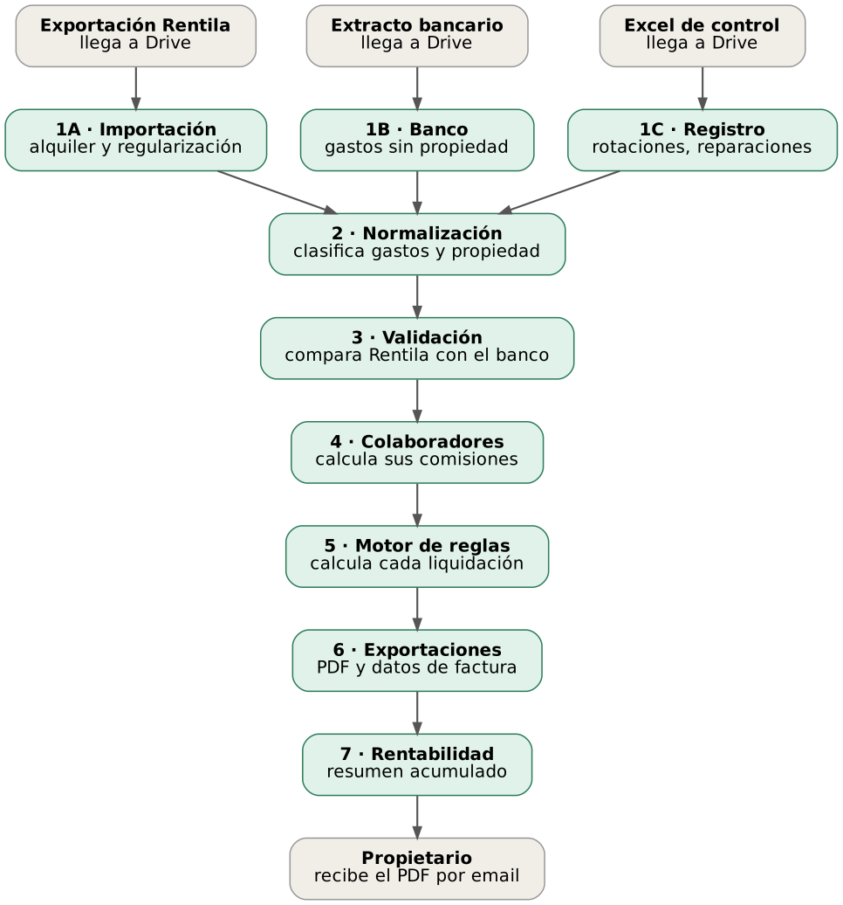

# 🏠 Property Settlement Automation

> Monthly owner-settlement automation for a property-management company: imports rent and bank data, reconciles it, applies business rules, and delivers a PDF settlement and invoice data to each owner — no manual calculation.

[](https://n8n.io)
[](https://www.postgresql.org)
[](https://docker.com)
[](#project-status)
[](LICENSE)

🇪🇸 [Leer en español](README.ES.md)

---

## What problem does it solve?

A property-management company settles ~80 properties and ~30 owners every month. Each settlement mixes rent, utilities, expenses, management fees, VAT, room turnovers and repairs, with different rules per management type. Doing it in spreadsheets was slow and error-prone.

This system does the whole cycle automatically and **flags anything doubtful for human review instead of guessing**.

> Built as a freelance project for a real client (3 milestones, accepted and delivered). This repository is a **sanitized public version**: no client data, credentials or real identifiers.

## Highlights

- **Deterministic rules engine, no LLM.** Fees, VAT, repair margins and thresholds are plain, auditable calculations. Every settlement stores its full breakdown (`detalle_calculo`, JSONB).
- **PostgreSQL as the business core**, not spreadsheets. Idempotent imports (unique keys + `ON CONFLICT`), one settlement per property and month.
- **Bank reconciliation** between the rent platform export and the bank statement, with explicit states: `validado`, `pendiente_validar`, `descuadrado`, `pago_parcial`.
- **PDF generation** with Gotenberg (HTML → PDF) and invoice-ready data per concept.
- **Business parameters in a table** (`configuracion`), changeable with one `UPDATE` — no workflow edits.
- **Validated against ground truth:** results matched the client's historical figures exactly on every property tested.
- **Operations included:** daily `pg_dump` backups, centralized error handler with email alerts, execution logs, restore procedure and handover documentation.

## Architecture



| Workflow | Purpose |
|---|---|
| 1A · Rent-platform import | Reads the monthly rent-platform export (income + bank regularization) from Drive into PostgreSQL |
| 1B · Bank import | Imports bank-statement expenses, deduplicated by the bank's own transaction ID |
| 1C · Control sheet | Imports the client's own spreadsheet: room/traditional turnovers, repairs, partial payments |
| 2 · Normalization | Extracts contract periods, classifies expenses by keywords, resolves the property |
| 3 · Validation | Matches platform records against the bank and sets the reconciliation state |
| 4 · Collaborators | Computes external collaborator commissions |
| 5 · Rules engine | Loops over properties and computes income, fees, VAT, rotations, repairs and net payout |
| 6 · Exports | PDF, invoice data, separate invoices and email delivery |
| 7 · Profitability | Cumulative per-property summary to a Sheet |
| 8 · Movement detail, Review panel | Manual: full movement list and "needs human review" list in Google Sheets |
| Logs / Error handler | Traceability and failure alerts |

Stack: n8n (self-hosted) · PostgreSQL 16 · Gotenberg · Google Drive/Sheets/Gmail · Caddy (HTTPS) · Docker Compose.

More detail: [docs/architecture.md](docs/architecture.md) · [docs/business-rules.md](docs/business-rules.md) · [docs/lessons-learned.md](docs/lessons-learned.md)

## Known limitations

An honest list, since this was built under real delivery constraints:

- **SQL built by string interpolation** inside n8n Postgres nodes (`'{{ $json.x }}'` with manual quote escaping). Inputs come from trusted internal files, but n8n *Query Parameters* would be the safer choice.
- **Some values are still hardcoded**: the VAT rate in the export/PDF templates (the rules engine does read it from `configuracion`), the keyword lists used to classify expenses, and a few location words in the property-matching step.
- **Log rows** from some workflows carry placeholder counters (e.g. `propiedades_procesadas = 1`) rather than real counts.
- Sub-workflows are referenced by n8n internal ID, so after importing you must re-select the target in every *Execute Workflow* node. If a *When Executed by Another Workflow* trigger misbehaves after import, delete and recreate it (Logs defines 10 input fields; the others use "Accept all data"), and set the *Error Workflow* in each workflow's settings again.
- No automated test suite: validation was done against the client's historical figures.

## Repository layout

```
├── assets/            flow diagram
├── database/
│   ├── schema.sql     reference schema (reconstructed from the project docs)
│   └── seed_demo.sql  fictional demo data
├── docs/              architecture, business rules, lessons learned
├── tools/
│   └── sanitize_workflows.py   cleans n8n exports before publishing
├── workflows/         the 13 sanitized n8n workflows
├── .env.example
└── SECURITY.md
```

## Try it

```bash
createdb settlements
psql settlements -f database/schema.sql
psql settlements -f database/seed_demo.sql
```

Then import the JSON files from `workflows/` in n8n (all are exported inactive), create your own Postgres/Google credentials, replace every `REPLACE_WITH_YOUR_*` placeholder with your Drive folder / Sheet IDs and re-link the *Execute Workflow* nodes. Workflow notes inside n8n (sticky notes) are in Spanish.

## Project status

Delivered and handed over to the client in October 2026 (Google access revoked, n8n admin transferred, documentation and backups provided). This public repository is not maintained as a product.

## Author

**Alejandro Peralta** — Process Automation Specialist · [GitHub](https://github.com/alejandro-orbis) · [LinkedIn](https://linkedin.com/in/alejandro-orbis)
